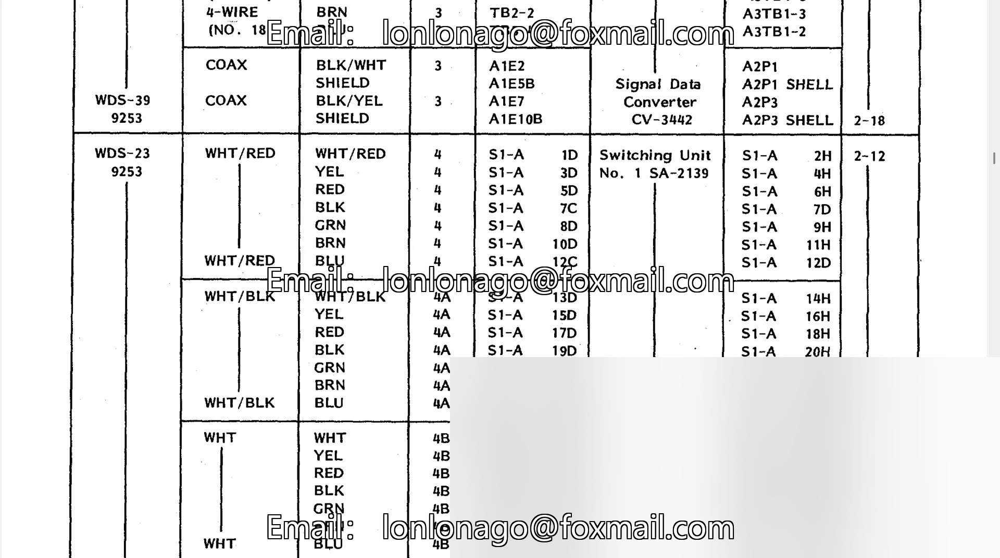
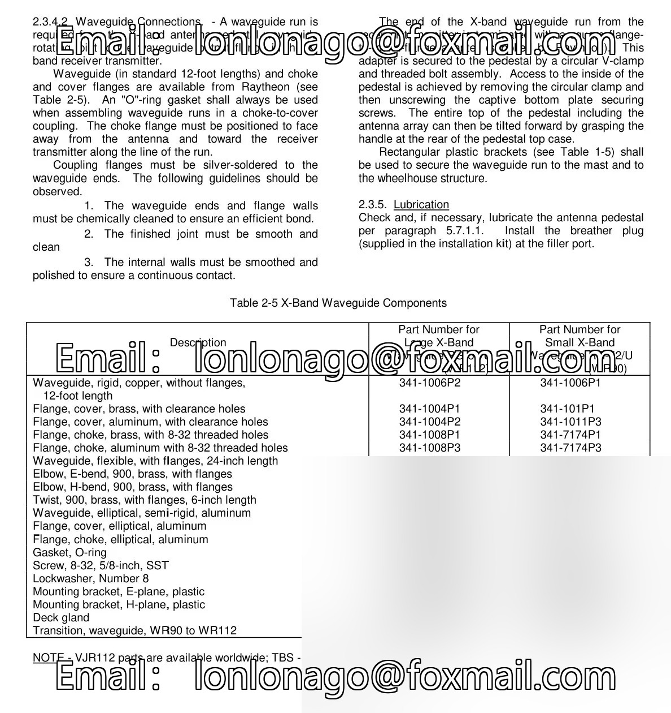

# SPS-64 Ship Probe Mine Repair Manual, three volumes.

## Body

SPS-64 ship detection lightning cable repair manual, three volumes.
Including detailed circuit diagrams, structural diagrams, repair instructions, and other content, it covers the lightning cable system components, working principles, and repair procedures, suitable for technical study reference.
non-returnable after sale.

This is a surface search and navigation system used by the U.S. Navy and multiple countries' naval vessels, developed by Rheinmetall, with the code name "Navigator Path finder".

Adopting modular design, supporting multiple configurations, used for naval ship anti-sunkening search, target tracking and navigation obstacle avoidance.

Working frequency includes X band (approximately 9.375 GHz) or S band (approximately 3.03 GHz), maximum detection distance approximately 118 kilometers.

This is the SPS-64 ship detection radar da maintenance manual covering three volumes, including circuit diagrams, structural diagrams, repair instructions, and content on the da system components, principles and maintenance processes, suitable for technical learning.

<!-- AI_ENRICHED -->

## Images

## Payment

Here is a pay link on Stripe ( https://buy.stripe.com/3cs8yP7sY87d0vu9AB ). Please contact me lonlonago@foxmail.com after funding $89, and I will send you a complete data files , thank you!

